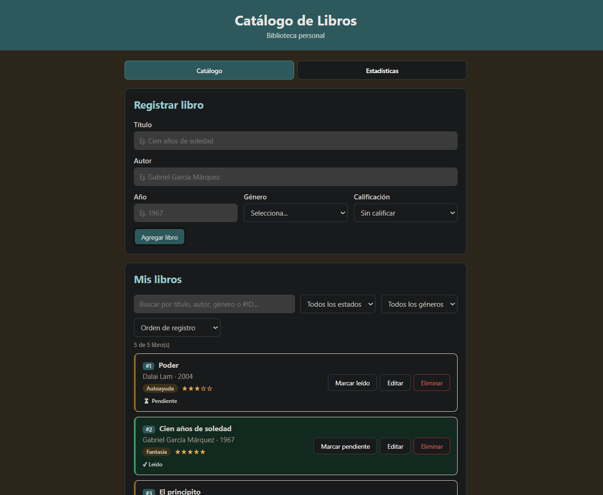
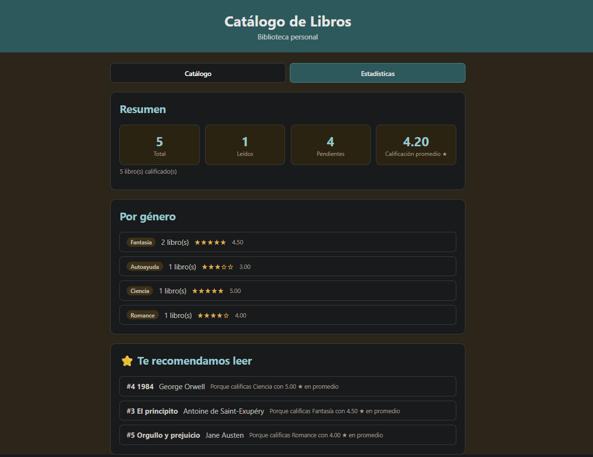
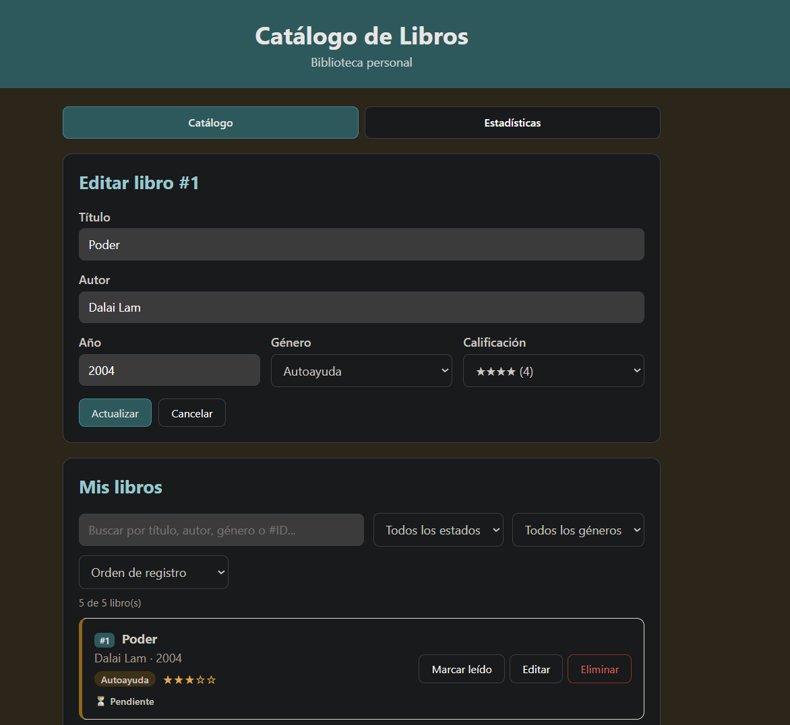
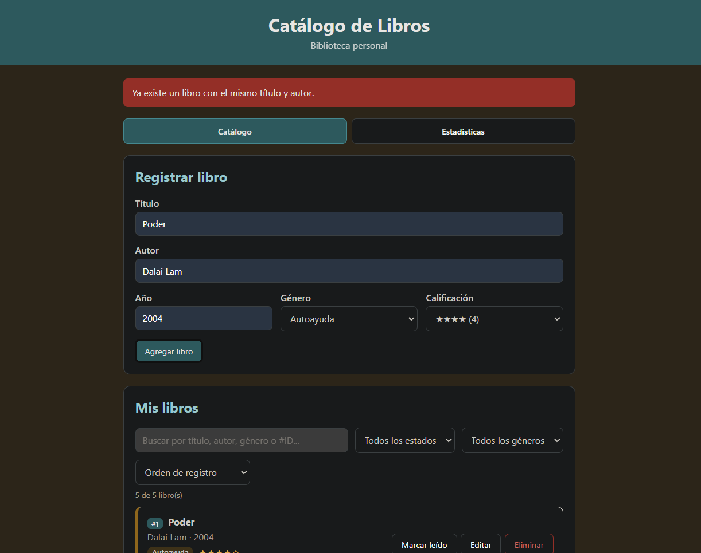
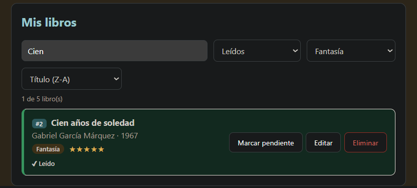
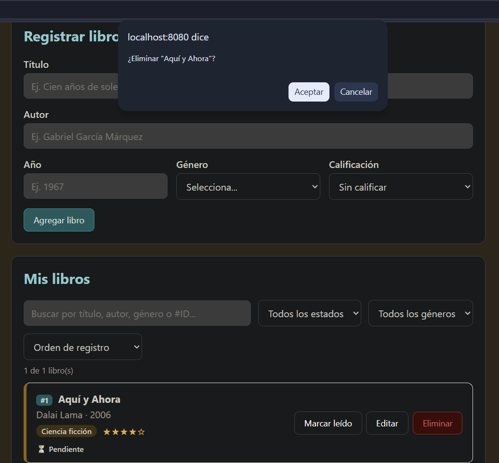
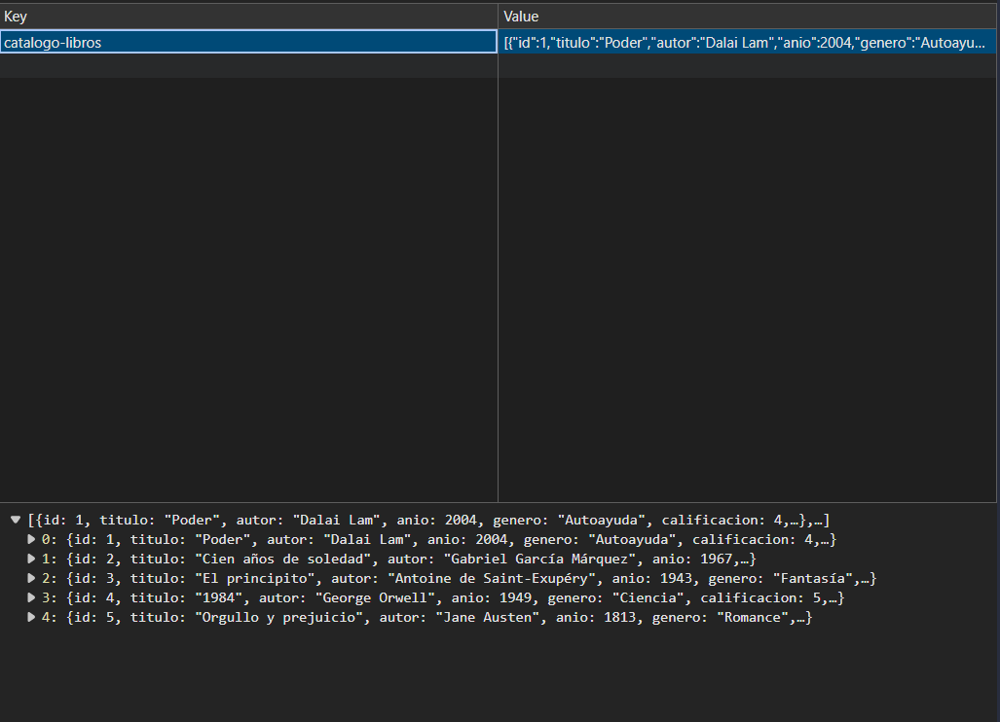

#  Catálogo de Libros

Aplicación web para administrar un catálogo personal de libros. Desarrollada con **TypeScript** siguiendo la arquitectura **MVC**, sin frameworks, con persistencia en `localStorage`.

> Este proyecto es la continuidad del **Laboratorio #2** y corresponde a la actualización del **Parcial 2**. La explicación de las mejoras y las decisiones de diseño está en la sección [Documento técnico](#documento-técnico).

## Ejecución del proyecto

Estas son las instrucciones para descargar y ejecutar el proyecto desde una computadora nueva. El procedimiento fue probado desde otro equipo.

### Requisitos previos

Antes de comenzar, instala:

- **Node.js 18 o superior**, que incluye `npm`.
- **Git**, para descargar el repositorio.
- Un navegador web actualizado, como Chrome, Edge, Firefox o Safari.

Puedes comprobar que Node.js y npm estén instalados ejecutando:

```bash
node --version
npm --version
```

### 1. Descargar el repositorio

Clona el repositorio y entra en la carpeta del proyecto:

```bash
git clone https://github.com/IsviCastillo/Laboratorio-2-POE.git
cd Laboratorio-2-POE
```

Si ya descargaste el proyecto como archivo `.zip`, descomprímelo y abre una terminal dentro de la carpeta que contiene `package.json`.

### 2. Instalar las dependencias

Ejecuta:

```bash
npm install
```

Este comando instala las dependencias declaradas en `package.json` y prepara el proyecto para compilarse. También crea o actualiza la carpeta `node_modules`.

### 3. Compilar TypeScript

Ejecuta:

```bash
npm run build
```

Este comando compila los archivos TypeScript de `src/` y genera los archivos JavaScript en `dist/`. Debe finalizar sin errores antes de iniciar la aplicación.

### 4. Iniciar el servidor

Ejecuta:

```bash
npm start
```

El proyecto se servirá localmente en:

<http://localhost:8080>

Abre esa dirección en el navegador para utilizar el catálogo.

### Resumen de comandos

Después de descargar el repositorio, los tres comandos principales son:

```bash
npm install
npm run build
npm start
```

Para detener el servidor, regresa a la terminal y presiona `Ctrl + C`.

> No abras `index.html` directamente con `file://`. La aplicación utiliza módulos ES y debe ejecutarse mediante un servidor HTTP con `npm start` o con una extensión como *Live Server* de VS Code.

### Solución de problemas

#### `npm` o `node` no se reconoce

Instala Node.js desde <https://nodejs.org/> y reinicia la terminal. Comprueba la instalación con:

```bash
node --version
npm --version
```

#### El comando `npm run build` muestra errores

Confirma que estás dentro de la carpeta correcta y que ejecutaste primero `npm install`:

```bash
pwd
ls
npm install
npm run build
```

En Windows, el equivalente de `pwd` y `ls` puede ejecutarse también como:

```powershell
Get-Location
Get-ChildItem
```

#### El navegador no abre la aplicación

Comprueba que `npm start` siga ejecutándose en la terminal y visita manualmente <http://localhost:8080>. Si el puerto está ocupado, cierra el proceso que lo utiliza o reinicia la terminal.

#### Los libros no aparecen después de cerrar el navegador

Los datos se guardan en el `localStorage` del navegador y del mismo origen (`http://localhost:8080`). Si cambias de navegador, eliminas los datos del sitio o abres el proyecto con otra dirección, verás un almacenamiento diferente.

## Funcionalidades

- Registrar libros con título, autor, año, **género** y **calificación** (1-5 estrellas).
- Listar libros en tarjetas, con etiqueta de género y estrellas.
- **Editar** libros: el formulario carga los datos y el botón cambia a "Actualizar".
- **Eliminar** con confirmación.
- **Buscar** por título, autor, género o ID (`#3`) en tiempo real.
- **Filtrar** por estado y por género (selectores), combinados con la búsqueda.
- **Ordenar** por título (A-Z / Z-A) o por año (ascendente / descendente).
- Marcar libros como leídos o pendientes.
- **Estadísticas**: total, leídos, pendientes, calificación promedio y resumen por género.
- **Recomendaciones**: libros pendientes de los géneros mejor calificados por el usuario.
- **Dos vistas (pestañas)**: Catálogo y Estadísticas.
- Notificaciones de éxito y error que se cierran solas.
- Persistencia automática en `localStorage`.

## Capturas de pantalla

### Catálogo
Formulario de registro y lista de libros con género, calificación y estado.



### Estadísticas y recomendaciones
Contadores, calificación promedio, resumen por género y libros recomendados.



### Edición de un libro
El formulario carga los datos del libro y el botón cambia a "Actualizar".



### Validaciones
Mensajes de error específicos por tipo de problema.



### Búsqueda y filtros combinados
Búsqueda por texto, género, estado y orden aplicados a la vez.



### Eliminar con confirmación



### Persistencia en localStorage
Los datos quedan guardados en el navegador bajo la clave `catalogo-libros`.



## Arquitectura MVC

| Capa | Archivo | Responsabilidad |
|------|---------|-----------------|
| Model | `src/models/Libro.ts` | Datos del libro, tipos y validaciones de campos (regex, rangos) |
| Model | `src/models/LibroModel.ts` | Colección: CRUD, IDs, duplicados, filtros, orden, estadísticas y recomendaciones |
| View | `src/views/LibroView.ts` | Renderiza lista, estrellas, estadísticas y mensajes; captura eventos del DOM |
| Controller | `src/controllers/LibroController.ts` | `handleAdd`, `handleUpdate`, `handleDelete`, `handleSort`...; coordina Modelo, Vista y Servicio |
| Service | `src/services/StorageService.ts` | Lectura y escritura en `localStorage` |
| Entrada | `src/main.ts` | Crea las instancias y arranca la app |

### Métodos principales

- **`LibroModel`**: `addLibro`, `updateLibro`, `deleteLibro`, `toggleLeido`, `filterByGenero`, `filterByEstado`, `sortByTitulo`, `sortByAnio`, `consultar`, `getEstadisticas`, `getRecomendaciones`.
- **`LibroView`**: `renderLista`, `renderEstrellas`, `renderEstadisticas`, `entrarModoEdicion`, `mostrarMensaje`.
- **`LibroController`**: `handleAdd`, `handleUpdate`, `handleDelete`, `handleSort`, `handleSearch`, `handleFilterEstado`, `handleFilterGenero`.

### Flujo

1. El usuario interactúa con la **Vista** (formulario, búsqueda, selectores, botones).
2. La Vista notifica al **Controlador** mediante manejadores (`ManejadoresVista`).
3. El Controlador usa el **Modelo** para aplicar las reglas y el **Servicio** para persistir.
4. El Controlador pide a la Vista que se redibuje (lista y estadísticas).

La Vista no conoce el almacenamiento y el Modelo no conoce el DOM.

## Uso de TypeScript

- **Clases**: `Libro` (datos y validaciones) y `LibroModel` (reglas de la colección).
- **Interfaces**: `LibroData`, `LibroInput`, `Estadisticas`, `ResumenGenero`, `Recomendacion`, `CriteriosConsulta`, `ManejadoresVista`.
- **Tipos unión**: `FiltroEstado`, `CriterioOrden`, `TipoMensaje`.
- **Constante tipada**: `GENEROS` (`as const`).
- Modo `strict` activado en `tsconfig.json`.

## Estructura

```
Laboratorio-2-POE/
├── index.html
├── package.json
├── tsconfig.json
├── .gitignore
├── docs/                      ← capturas de pantalla
├── src/
│   ├── main.ts
│   ├── models/
│   │   ├── Libro.ts
│   │   └── LibroModel.ts
│   ├── views/
│   │   └── LibroView.ts
│   ├── controllers/
│   │   └── LibroController.ts
│   ├── services/
│   │   └── StorageService.ts
│   └── styles/
│       └── styles.css
└── README.md
```

## Validaciones

| Campo | Regla | Mensaje |
|---|---|---|
| Título | Mínimo 2 caracteres y al menos una letra o número (regex) | "El título es obligatorio..." / "El título debe contener letras o números." |
| Autor | Mínimo 2 caracteres; solo letras, espacios, puntos, guiones y apóstrofes (regex) | "El autor solo puede contener letras..." |
| Año | Entero entre 1000 y el año actual + 1 | "El año debe ser un número entero entre..." |
| Género | Debe ser uno de la lista | "Selecciona un género de la lista." |
| Calificación | Entero de 0 a 5 (0 = sin calificar) | "La calificación debe estar entre 1 y 5 estrellas..." |
| Duplicados | No puede repetirse el mismo título y autor (sin distinguir mayúsculas) | "Ya existe un libro con el mismo título y autor." |

## Sistema de recomendación (reto)

Se calcula el promedio de calificación de cada género (solo con libros calificados). Los géneros con promedio de **3 o más** se consideran favoritos, y se recomiendan los libros **pendientes** de esos géneros, ordenados de mayor a menor promedio. Aparecen en la pestaña Estadísticas.

---

# Documento técnico

## 1. Objetivo

Extender el Catálogo de Libros del Laboratorio #2 manteniendo la arquitectura MVC, incorporando nuevas funcionalidades que demuestren un mayor dominio de TypeScript, manejo de eventos, validaciones y persistencia de datos.

## 2. Qué cambió respecto al Laboratorio #2

| Aspecto | Laboratorio #2 (base) | Parcial 2 (actualización) |
|---|---|---|
| Entidades | `Libro` con título, autor y año | `Libro` con género y calificación, relacionado con el catálogo de géneros (`GENEROS`) |
| CRUD | Registrar y listar | Completo: crear, listar, editar y eliminar con confirmación |
| Búsqueda | Por título o autor | Por título, autor, género o ID |
| Filtros | Por estado (botones) | Por estado y género (selectores), combinados con la búsqueda |
| Orden | No | Por título o año, ascendente o descendente |
| Validaciones | Campos vacíos | Regex, rangos, duplicados y mensajes específicos por error |
| Persistencia | `localStorage` | `localStorage` con migración de datos de versiones anteriores |
| Interfaz | Una vista | Dos vistas (pestañas): Catálogo y Estadísticas |
| Mensajes | Éxito y error | Notificaciones que se cierran solas a los 4 segundos |
| Estadísticas | No | Total, leídos, pendientes, promedio y resumen por género |

## 3. Cumplimiento de requerimientos

### Requerimientos funcionales

| Req. | Descripción | Implementación |
|---|---|---|
| RF-01 | Género y calificación (1-5 estrellas) | `Libro.genero`, `Libro.calificacion`; selectores en el formulario; `LibroView.renderEstrellas()` |
| RF-02 | Editar libros | `LibroModel.updateLibro()`, `LibroController.handleUpdate()`, `LibroView.entrarModoEdicion()` |
| RF-03 | Eliminar con confirmación | `LibroModel.deleteLibro()`, `LibroController.handleDelete()` con `window.confirm` |
| RF-04 | Filtrar por género y estado | `LibroModel.filterByGenero()` y `filterByEstado()`; selectores con evento `change` |
| RF-05 | Ordenar por título o año | `LibroModel.sortByTitulo()` y `sortByAnio()`; `LibroController.handleSort()` |
| RF-06 | Guardar en `localStorage` | `StorageService.cargar()` y `guardar()` |
| RF-07 | Estadísticas (total, leídos, pendientes) | `LibroModel.getEstadisticas()`; `LibroView.renderEstadisticas()` |
| RF-08 | Buscar por título, autor o género | `Libro.coincideCon()` (también por ID) |
| RF-09 | Promedio de calificaciones | `LibroModel.getEstadisticas().promedio` |
| Reto | Sistema de recomendación | `LibroModel.getRecomendaciones()` |

### Requerimientos técnicos

| Requerimiento | Implementación |
|---|---|
| Persistencia con `StorageService` | Clase propia que encapsula `localStorage`; carga automática al iniciar en `main.ts` |
| Modo edición | Al pulsar "Editar" se cargan los datos en el formulario y el botón cambia a "Actualizar" |
| Búsqueda con evento `input` | Input de búsqueda en tiempo real |
| Filtros con evento `change` | Selectores de estado, género y orden |
| Filtros combinados | `LibroModel.consultar()` aplica en cadena: búsqueda → estado → género → orden |
| Validación con regex | Título y autor (ver sección Validaciones) |
| Validación de rangos | Año (1000 hasta el año actual + 1) y calificación (0 a 5) |
| Impedir duplicados | `LibroModel.existeDuplicado()` |
| Mensajes específicos por error | `Libro.validar()` devuelve una lista de errores, uno por cada problema |

## 4. Decisiones de diseño

1. **Un modelo que gestiona la colección (`LibroModel`).** La clase `Libro` representa un solo libro y sus validaciones. `LibroModel` administra la lista: CRUD, IDs, duplicados, filtros, orden, estadísticas y recomendaciones. Así el controlador solo coordina, y las reglas de negocio quedan en el modelo, sin depender del DOM ni del almacenamiento.

2. **IDs numéricos consecutivos.** `LibroModel` calcula el siguiente ID como el máximo existente más uno al construirse. Son legibles para el usuario (`#3`) y permiten buscar por ID.

3. **Calificación opcional (0 = sin calificar).** Un libro pendiente aún no tiene nota. Por eso el promedio solo cuenta los libros con calificación mayor a 0, y así los pendientes no bajan el promedio.

4. **Lista fija de géneros (`GENEROS`, `as const`).** Evita errores de escritura, permite validar que el género sea válido y alimenta los selectores del formulario y del filtro desde una sola fuente.

5. **Adaptación de las validaciones del parcial.** El parcial menciona validar email y montos, que no aplican a un catálogo de libros. Se adaptó así: regex para el autor (solo letras, espacios, puntos, guiones y apóstrofes) y para el título (al menos una letra o número), y rangos numéricos para el año y la calificación.

6. **Detección de duplicados.** Se compara título y autor sin distinguir mayúsculas ni espacios sobrantes. Al editar, el libro no se compara consigo mismo, de modo que se pueden guardar cambios sin que choque con su propio registro.

7. **Búsqueda y filtros en una sola consulta.** `consultar()` recibe un objeto con texto, estado, género y orden, y los aplica en cadena. Por eso los filtros siempre se combinan, y la vista no necesita saber cómo funciona.

8. **Eventos `input` y `change`.** La búsqueda usa `input` para responder mientras se escribe; los selectores usan `change`, el evento propio de ese control.

9. **Dos pestañas sin recargar la página.** Catálogo y Estadísticas son dos paneles que se muestran u ocultan con el atributo `hidden`. Es un cambio puramente visual, resuelto en la vista, sin lógica de negocio.

10. **Sistema de recomendación.** Se recomiendan los libros pendientes de los géneros cuyo promedio es 3 o más. Se eligió este umbral para no sugerir géneros que el usuario calificó mal.

11. **Compatibilidad con datos anteriores.** Los libros guardados antes del parcial no tienen género ni calificación. `StorageService` los carga con "Otros" y "Sin calificar", y renumera los IDs si no eran enteros. Así no se pierde información al actualizar.

12. **Seguridad.** La vista escapa el texto del usuario antes de insertarlo con `innerHTML`, para evitar inyección de HTML.

## 5. Casos de prueba

| # | Acción | Resultado esperado |
|---|---|---|
| 1 | Enviar el formulario vacío | Mensajes de error de título, autor, año y género |
| 2 | Registrar un libro válido | Aparece como `#1` con su género y estrellas; mensaje de éxito |
| 3 | Registrar el mismo título y autor (en mayúsculas) | Error: "Ya existe un libro con el mismo título y autor." |
| 4 | Autor con números (`123 Autor`) | Error de formato del autor |
| 5 | Buscar por título, autor, género y `#ID` | La lista muestra solo los libros que coinciden |
| 6 | Búsqueda + género + estado a la vez | La lista cumple todos los criterios combinados |
| 7 | Ordenar por título A-Z / Z-A y por año | La lista cambia de orden en cada caso |
| 8 | Pulsar "Editar" | Formulario con los datos cargados y botón "Actualizar" |
| 9 | Guardar cambios sin modificar nada | Se acepta, sin error de duplicado |
| 10 | Marcar un libro como leído | Cambia su estado; las estadísticas se actualizan |
| 11 | Eliminar y cancelar la confirmación | El libro no se elimina |
| 12 | Eliminar y aceptar la confirmación | El libro desaparece; las estadísticas se actualizan |
| 13 | Recargar la página (`Ctrl+F5`) | Los libros siguen ahí y el siguiente ID continúa la numeración |
| 14 | Pestaña Estadísticas | Total, leídos, pendientes, promedio, resumen por género y recomendaciones |
| 15 | Registrar un título con HTML (`<b>x</b>`) | Se muestra como texto, no se interpreta |

## 6. Limitaciones y mejoras futuras

- Si se elimina el libro con el ID más alto y se recarga la página, ese número puede reutilizarse.
- Los datos viven en el `localStorage` de cada navegador: no se comparten entre equipos ni navegadores.
- La lista de géneros es fija. Una mejora sería permitir al usuario crear géneros propios.
- Se podría agregar exportación e importación del catálogo en JSON.
- Las pruebas son manuales; se podrían automatizar con una herramienta de pruebas del modelo.

## 7. Relación con la rúbrica

| Criterio | Dónde se cumple |
|---|---|
| CRUD completo | Registrar, listar, editar y eliminar con confirmación (secciones 3 y 5) |
| Persistencia | `StorageService` con `localStorage` y migración de datos |
| Búsqueda y filtros | Búsqueda por texto + filtros de estado y género + orden, combinados (`consultar()`) |
| Validaciones y UI | Regex, rangos y duplicados con mensajes específicos; pestañas, estrellas y notificaciones |
| Documentación y defensa | Este README: ejecución, arquitectura, documento técnico y capturas |